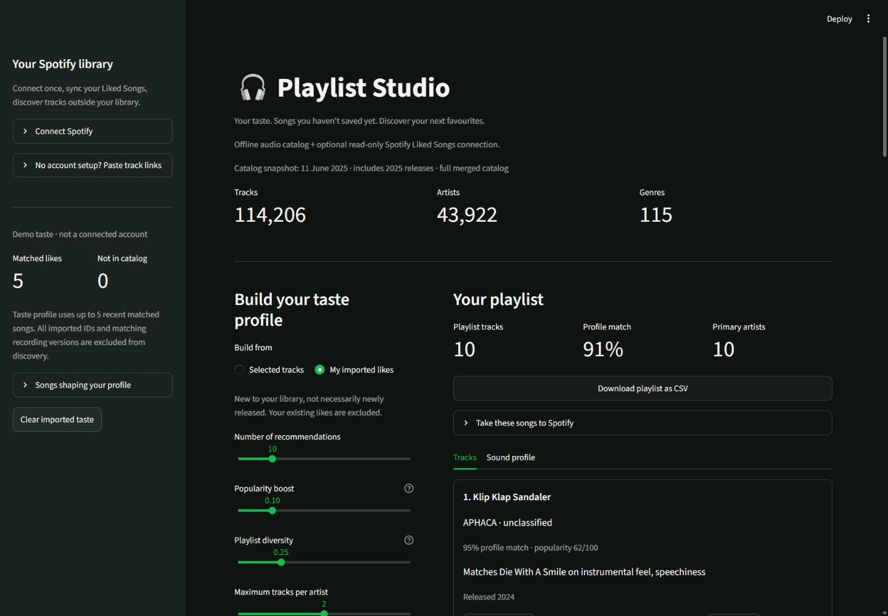
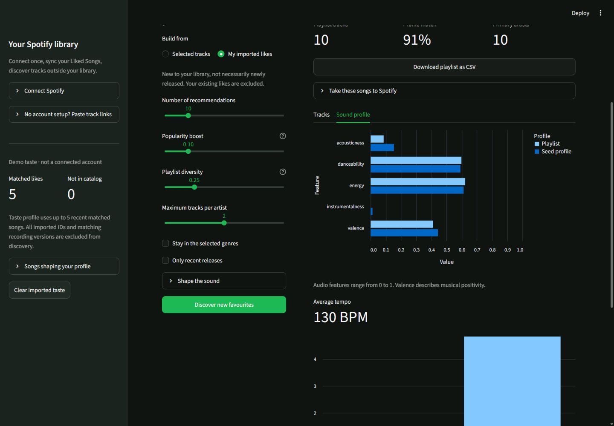
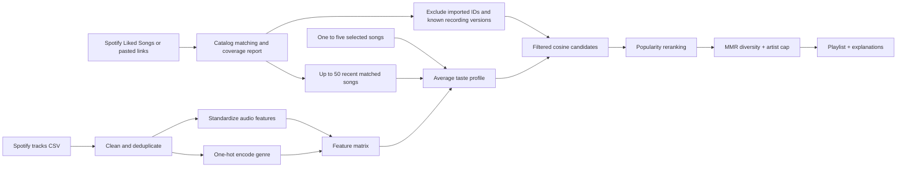

# Spotify Music Recommender 🎧

[](https://github.com/amkumirab/spotify-music-recommender/actions/workflows/ci.yml)
[](https://www.python.org/)
[](https://streamlit.io/)
[](LICENSE)

A personal music discovery app that reads your Spotify Liked Songs and suggests
tracks outside your library. It uses an attributed offline catalog of **114,206
unique tracks**, including releases through **2025**, with audio similarity and
playlist diversity controls. Manual song selection and an offline demo work
without a Spotify developer account.

> This is an educational project. It is not affiliated with or endorsed by Spotify.

## Preview

Actual app screenshots using a public demo taste, not a personal Spotify account.





## Discover from your Liked Songs

1. Follow the [one-time Spotify connection setup](docs/spotify-setup.md).
2. Connect in the sidebar and click **Sync Liked Songs**.
3. Review how many likes matched the audio catalog, then click **Discover new favourites**.
4. Open suggested tracks in Spotify, hide misses, and save the result locally,
   download CSV / Spotify URI text, or **Save to Spotify** as a private playlist.

The connection requests `user-library-read` by default. **Allow saving private
playlists** adds the optional `playlist-modify-private` permission. Tokens stay
in memory and no Client Secret is required. Imported likes and their known recording
variants are excluded from discovery. Up to 50 recent matched likes shape your taste profile;
unmatched songs are reported rather than assigned invented audio features.
See the [local data and privacy guide](docs/privacy.md) for storage, disconnection
and safe screenshot sharing.

Here **new** means not already liked. Turn on **Only recent releases** to restrict
results by known album release year. The catalog ends in June 2025; this is not a
live new-release feed. Spotify restricts audio-feature access for new apps, so
catalog coverage remains a real limitation.

Without a developer app, expand **No account setup? Paste track links** in the
sidebar. Paste copied Spotify track URLs or choose **Try a demo taste**. The demo
is visibly labeled and never claims to be connected to your account.

## Highlights

- Content-based recommendation with explainable results
- Read-only-by-default Spotify connection with PKCE, library pagination and token refresh
- Opt-in private Spotify playlist saving with preview, confirmation and duplicate protection
- Discovery that excludes all imported likes and known alternate recording IDs
- Match coverage report, explicit unmatched songs and recent-release filtering
- Multi-track taste profiles built from one to five seed songs
- Playlist Studio with persistent results, local saved playlists, and hide/restore feedback
- Energy, mood, and tempo filters applied across the catalog before retrieval
- Audio profile comparison and genre breakdown for each playlist
- Nine audio signals: energy, valence, danceability, tempo, acousticness, and more
- Maximum Marginal Relevance (MMR) diversity and per-artist limits
- Optional popularity reranking and selected-genre filtering
- Fast interactive Streamlit interface with Spotify deep links
- Downloadable CSV playlists with ranking, match scores, and Spotify links
- Reproducible offline evaluation for relevance, diversity, and catalog coverage
- Reproducible public Kaggle dataset download
- Unit tests, linting, coverage, and GitHub Actions CI
- Full dataset fallback to a small repository sample

## How it works



The recommender is deliberately content-based: manual mode does not require user history.
It averages the selected tracks into a single audio-and-genre profile, retrieves
the closest candidates, and applies MMR so the final playlist stays relevant
without becoming repetitive. Imported-library mode uses matched likes instead.
Unknown genre labels contribute no genre similarity. Match percentages describe
audio similarity, not the probability that you will like a song.

## Run locally

Clone the repository and enter the project directory:

```bash
git clone https://github.com/amkumirab/spotify-music-recommender.git
cd spotify-music-recommender
```

Create a virtual environment:

```bash
python -m venv .venv
```

Activate the environment on Windows:

```powershell
.\.venv\Scripts\Activate.ps1
```

Install the project and development tools:

```bash
python -m pip install -e ".[dev]"
```

The repository includes a balanced sample covering all 114 genres, so the app
can run immediately. To download the complete Kaggle dataset, optionally run:

```bash
python scripts/download_data.py
python scripts/update_catalog.py
```

Start the application:

```bash
python -m streamlit run app.py
```

Open `http://localhost:8501`, search for tracks or artists, add one to five seed
tracks, adjust popularity and diversity, and build the playlist. Downloading the
complete dataset gives the best results; otherwise the app automatically uses the
repository sample. Use **Download playlist as CSV** to save the ranked results in
a spreadsheet-friendly format.

### Playlist Studio

1. Search for a title or artist and add up to five songs to your profile.
2. Open **Shape the sound**, enable audio filters, and set energy, mood (valence),
   or tempo ranges. All ranges include their endpoints.
3. Build a playlist. Results stay visible when searching, editing controls, or
   downloading. A notice marks pending profile changes until you build again.
4. Use **Hide track** to remove a result and exclude it from future builds in
   this session. **Restore hidden tracks** makes those songs eligible again.
5. Open **Sound profile** to compare average audio features with your seed tracks
   and inspect tempo and genre distribution.
6. Enter a name and choose **Save playlist locally**. Reopen snapshots from
   **Saved playlists**, even after restarting the app, then download them as CSV.

Saved snapshots preserve the generated track order and the settings used at
generation time. Reopening a snapshot does not change the current controls;
building again uses the current profile. Each save creates a separate snapshot.

The library is stored in `data/local/library.db` and excluded from Git. Back up
that file to keep your playlists. This is a local, single-user application;
saved playlists are shared by users of the same running installation. A hosted
multi-user deployment needs authentication and isolated user storage first.
Saving locally does not create playlists in a Spotify account.

### Save directly to Spotify

1. In the sidebar, choose **Allow saving private playlists** before connecting.
   Already connected read-only? Click **Enable private playlist saving**, sign in
   again and click **Finish connection**. Your current recommendations stay visible.
2. Build a playlist, enter its name, and review **Save to Spotify**.
3. Check **Create this private playlist in my Spotify account**, then click
   **Save private playlist to Spotify**. Open the returned playlist link.

The app creates a new **private** playlist with the displayed track order. It does
not change your Liked Songs or existing playlists. Each export supports up to 100
unique tracks (the generator currently produces at most 30).

Repeated saves of the same trimmed name and ordered tracks reuse the result for
the current connection. Writes are never automatically retried: a network failure
may mean Spotify accepted a request without returning its response. If the outcome
is uncertain, check Spotify manually; the app keeps the playlist link when known.
Reconnecting or restarting clears this in-memory protection, so check before
trying the same export again. Changing the name or tracks requires fresh confirmation.
See [private export behavior](docs/spotify-export.md) for acceptance criteria and failure semantics.

Optional environment variables: `SPOTIFY_CLIENT_ID` supplies your public Spotify
app Client ID. `SPOTIFY_DATASET` selects a different dataset
CSV, and `SPOTIFY_LIBRARY` selects a different SQLite library path. Absolute
paths are recommended. Tests use isolated temporary libraries.

## Evaluate recommendation quality

Run the offline benchmark against 25 reproducibly sampled seed tracks:

```bash
python scripts/evaluate_model.py
```

Use the repository sample or save a machine-readable report when needed:

```bash
python scripts/evaluate_model.py \
  --dataset data/sample/spotify_tracks_sample.csv \
  --sample-size 20 \
  --recommendations 10 \
  --output reports/evaluation.json
```

The report contains four complementary quality signals:

- **Mean profile match:** average cosine similarity between seeds and results
- **Artist diversity:** average share of unique primary artists in each playlist
- **Genre diversity:** average share of unique genres in each playlist
- **Catalog coverage:** share of the catalog reached across all evaluated playlists

All ratio metrics range from `0.0` to `1.0`. The random state and ranking settings
are included in the JSON output so benchmark runs can be reproduced exactly.

## Dataset

The base catalog uses the
[Spotify Tracks Dataset | Audio Features](https://www.kaggle.com/datasets/saichaitanyareddyai/spotify-tracks-dataset-audio-features)
from Kaggle. It contains roughly 114K rows from 114 genres and is listed as CC0.
See [`data/DATASET.md`](data/DATASET.md) for attribution and reproducibility details.

The expanded catalog also uses **Asaniczka's Top Spotify Songs in 73 Countries**,
pinned to Kaggle version 608 (11 June 2025), under **ODC-By**. The merger keeps
complete observed audio features and honest `unclassified` genres where needed.
The 2,780-track repository sample includes this expansion and carries the same
attribution. [`data/catalog_manifest.json`](data/catalog_manifest.json) records
the archive checksum, source date, license and counts.

The raw data is not committed to Git. The download script calls Kaggle's public
dataset endpoint and extracts the archive into `data/raw/`.

## Project structure

```text
spotify-music-recommender/
├── .github/workflows/ci.yml
├── data/
│   ├── raw/                    # full Kaggle data (gitignored)
│   ├── sample/                 # small reproducible demo data
│   ├── local/                  # private local library (gitignored)
│   ├── catalog_manifest.json   # source version, dates and checksum
│   └── DATASET.md
├── docs/images/                # public demo screenshots
├── docs/spotify-setup.md
├── scripts/download_data.py
├── scripts/evaluate_model.py
├── scripts/update_catalog.py
├── src/spotify_recommender/
│   ├── account_ui.py           # connection, sync and match coverage
│   ├── catalog.py              # merge observed chart audio features
│   ├── data.py                 # validation, cleaning, search
│   ├── discovery.py            # match and exclude imported likes
│   ├── evaluation.py           # offline recommendation quality metrics
│   ├── library.py              # local SQLite playlist snapshots
│   ├── studio.py               # playlist controls and sound comparison
│   ├── export.py               # spreadsheet-friendly playlist export
│   ├── profile_ui.py           # manual taste selection
│   ├── spotify.py              # PKCE, library API and opt-in private exports
│   ├── spotify_export_ui.py    # export preview, confirmation and result
│   └── model.py                # features, similarity, ranking
├── tests/
├── app.py
└── pyproject.toml
```

## Development

```bash
python -m ruff check .
python -m pytest --cov=spotify_recommender --cov-report=term-missing
```

The GitHub Actions workflow runs lint, tests and dependency checks on Windows and
Linux for every push and pull request. Automated OAuth tests use a real loopback
callback with mocked Spotify responses; they never require account credentials.

Streamlit AppTest covers the build/search/hide/save/reopen flow, filter empty
states, and pending settings. Storage tests verify persistence across new library
instances. See [Playlist Studio design](docs/playlist-studio.md) for acceptance criteria.

## Roadmap

- Learn feature weights from likes/dislikes
- Package the model behind a FastAPI service

## License

Project code is released under the MIT License. Dataset licensing is documented
separately in [`data/DATASET.md`](data/DATASET.md).
